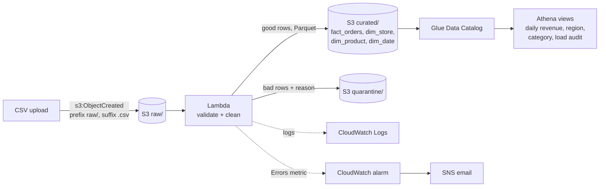
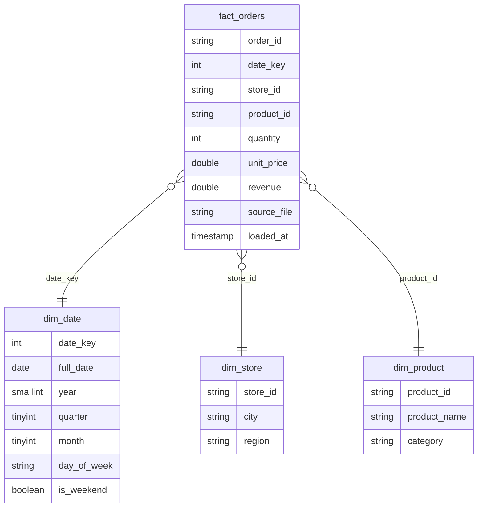

# Serverless Data Pipeline (AWS)

Event-driven ETL on AWS. Daily retail order CSVs land in S3, a Python Lambda
validates and cleans them, good rows are written as Parquet into a star schema,
bad rows are routed to a quarantine folder, and the curated data is queried with
SQL in Athena through shared metric views. All infrastructure is defined in
Terraform, so the whole thing comes up with one command and goes away with another.

> **Where it has run:** the Terraform stack has been deployed and exercised end to end
> on **LocalStack Community** (S3, Lambda, S3 trigger, IAM, CloudWatch, SNS), and CI does
> this on every push. It has **not** been deployed to a real AWS account. Glue and Athena
> are not in LocalStack Community, so on LocalStack the SQL views run in DuckDB over the
> Parquet read back from S3.



## What it does

| Step | Detail |
|---|---|
| Trigger | S3 event notification on `raw/*.csv` invokes the Lambda |
| Schema check | File must contain all 10 required columns, otherwise the whole file is copied to `quarantine/files/` |
| Row validation | Missing ids, unparseable dates, non-integer or non-positive quantity, negative or missing price, duplicate `order_id` |
| Cleaning | Trim whitespace, normalise category and region casing, cast types, compute `revenue` |
| Curated output | Parquet per table under `curated/<table>/<source file>.parquet` |
| Quarantine | Rejected rows with a `reject_reason` column under `quarantine/rows/` |
| Lineage | Every curated row carries `source_file` and `loaded_at` |
| Catalog | Four Glue tables over the curated prefixes, queryable from Athena |
| Metrics | SQL views in [`sql/views.sql`](sql/views.sql) so dashboards share one definition of revenue |
| Monitoring | CloudWatch log group (14 day retention) and an alarm on Lambda `Errors >= 1` over 5 minutes, sent to SNS |

### Star schema



Dimension rows are written once per source file. The `dim_*_current` views keep
the latest version of each key (by `loaded_at`), and the metric views join on those.

### Re-uploading the same file

Output keys are derived from the source file name, so uploading
`orders_2024-03-01.csv` again overwrites that file's curated Parquet rather than
adding a second copy. Revenue is never double counted for a re-sent file.

## Dataset

[`scripts/generate_sample_data.py`](scripts/generate_sample_data.py) produces one CSV per day, shaped like a
point-of-sale export: 10 stores in 4 regions, 12 products in 4 categories.
About 2% of rows are deliberately broken and about 1% are exported twice, so the
validation and quarantine path always has work to do. The generator is seeded,
so runs are reproducible.

## Project layout

```
lambda/
  handler.py        S3 event -> read CSV -> transform -> write Parquet / quarantine
  transform.py      validation, cleaning, star schema split (pure pandas, no AWS)
terraform/          S3, Lambda, IAM, S3 trigger, Glue, Athena, CloudWatch, SNS
sql/views.sql       shared metric views
scripts/
  generate_sample_data.py
  local_run.py      full pipeline on your machine with DuckDB, no AWS needed
  run_athena_sql.py run views.sql or ad hoc SQL against the deployed workgroup
  build_lambda_package.sh  handler + pandas/pyarrow in one zip (for LocalStack)
  localstack.sh     up | down: the Terraform stack on LocalStack
  localstack_run.py push the sample files through the deployed stack and record results
localstack/         docker-compose for LocalStack, provider override for Terraform
tests/              pytest: transform rules, Lambda against mocked S3, schema contract
```

## Run the tests

```bash
python -m venv .venv
source .venv/bin/activate          # Windows: .venv\Scripts\activate
pip install -r requirements-dev.txt
pytest -v
```

31 tests cover:

- every validation rule and its reject reason
- duplicate handling (first valid copy wins, a bad row does not block a later good one)
- lineage columns on every curated table
- the Lambda handler end to end against mocked S3 (moto): output layout, re-upload idempotency, whole-file quarantine, URL-encoded keys
- a schema contract test that parses `terraform/glue.tf` and checks the Parquet column types match, so a type change cannot silently break Athena

## Run locally (no AWS)

```bash
python scripts/generate_sample_data.py --days 7 --rows 5000
python scripts/local_run.py
```

This runs the same `transform.py` over every file, writes the same `curated/` and
`quarantine/` layout under `data/out/`, then creates the views from
`sql/views.sql` in DuckDB and prints them.

Measured locally (7 files, Windows laptop, Python 3.11):

| Metric | Value |
|---|---|
| Rows in | 35,351 |
| Rows curated | 34,283 |
| Rows quarantined | 1,068 (3.02%) |
| Transform time per file (~5,050 rows) | 97 to 172 ms |
| Throughput | ~44,000 rows/s |

## Deploy on LocalStack (free, no AWS account)

Needs Docker, Terraform 1.6+ and Python.

```bash
python scripts/generate_sample_data.py --days 7 --rows 5000
bash scripts/localstack.sh up          # LocalStack 3.8 + terraform apply in a "localstack" workspace
python scripts/localstack_run.py       # upload, wait for outputs, read CloudWatch Logs, query
bash scripts/localstack.sh down        # terraform destroy + stop LocalStack
```

`localstack.sh` copies [`localstack/localstack_override.tf`](localstack/localstack_override.tf) into
`terraform/` so the AWS provider points at `localhost:4566`, and applies with:

- `enable_athena=false`: no Glue database, Glue tables, Athena workgroup or results bucket
- `pandas_layer_arn=""` and `lambda_package_dir=build/package`: LocalStack Community has no
  Lambda layers, so pandas and pyarrow are bundled into the function zip (216 MB unzipped).
  That zip is over the direct-upload limit, so Terraform uploads it to S3 and the function
  is created from there.

The same files deploy to AWS unchanged with the defaults below.

### Results on LocalStack

Measured on 2026-10-13 against a fresh stack. These are two clean runs on this laptop
(Docker Desktop, LocalStack 3.8.1); [`docs/localstack-run.json`](docs/localstack-run.json) is the second.

| Metric | Value |
|---|---|
| Files / rows in | 7 / 35,351 |
| Rows curated / quarantined | 34,283 / 1,068 (3.02%), the same as the local DuckDB run |
| Lambda duration per file (~5,050 rows), from CloudWatch `REPORT` lines | median 95 ms and 117 ms (two runs). The first invocation took 329 ms and 510 ms |
| Upload to curated Parquet visible in S3, warm | median ~290 ms |
| First file after deploy | 14.2 s and 17.9 s, mostly LocalStack starting the Lambda container |
| Re-upload of `orders_2024-03-01.csv` | 29 curated objects before and after, same keys (idempotent) |
| File with a broken header | copied whole to `quarantine/files/`, logged as `file_quarantined` |
| Fact rows read back from S3 | 34,283, total revenue 5,786,005.12 |

The `localstack` CI job repeats this on every push and uploads the JSON as an artifact.
On the first green run (GitHub `ubuntu-latest`) the row counts and revenue were
identical, the Lambda median was 64 ms, and the run fails if any of these checks fail.

LocalStack timings are not AWS timings: there is no network hop to a region, and
cold starts work differently. LocalStack also does not enforce IAM by default, so
the least-privilege policy was deployed but not tested.

## Deploy to AWS (not run yet)

Requires Terraform 1.6+, the AWS CLI with credentials configured, and Python for the helper scripts.

```bash
cd terraform
terraform init
terraform apply                       # optional: -var alarm_email=you@example.com
cd ..

BUCKET=$(terraform -chdir=terraform output -raw data_bucket)
python scripts/generate_sample_data.py --days 7 --rows 5000
aws s3 cp data/raw/ s3://$BUCKET/raw/ --recursive

python scripts/run_athena_sql.py --file sql/views.sql
python scripts/run_athena_sql.py --query "SELECT * FROM v_daily_revenue ORDER BY full_date"
```

Lambda run summaries (rows in, curated, quarantined, duration) are logged as JSON
to the CloudWatch log group shown by `terraform output log_group`.

The Lambda uses the AWS SDK for pandas managed layer for pandas and pyarrow. The
default ARN is for `us-east-1`. For other regions, set `pandas_layer_arn` from the
[layer list](https://aws-sdk-pandas.readthedocs.io/en/stable/layers.html).

## Tear down

```bash
terraform -chdir=terraform destroy
```

Buckets are created with `force_destroy`, so this removes the data too.

## Design notes

- **Why serverless:** files arrive a few times a day. A Lambda that runs for a few
  hundred milliseconds per file costs almost nothing, compared with an always-on instance.
- **Least-privilege IAM:** the function can only read `raw/*` and only write to `curated/*` and `quarantine/*`.
- **Why the pure-pandas `transform.py`:** all business rules live outside the handler, so they are tested without AWS and reused by the local runner.
- **Athena guard rail:** the workgroup enforces a 1 GB scan limit per query, and query results expire after 7 days.
